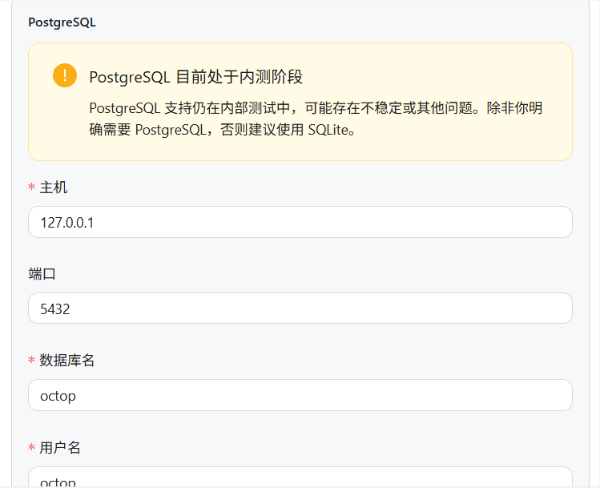

# 1. 拉源码
git clone https://github.com/TencentCloud/Octop.git
cd Octop

# 2. 启动（注意 compose 文件路径，仓库里可能在 docker/ 或 deploy/ 目录下）
docker compose -f docker/docker-compose.yml up -d
# 如果上面路径不对，试试这个：
# docker compose -f deploy/docker-compose.yml up -d

# 3. 看日志
docker compose -f docker/docker-compose.yml logs -f

项目	默认值
访问地址	http://127.0.0.1:8088
管理员账号	admin
管理员密码	octop
数据存储目录	~/.octop

OCTOP_PORT=8088              # 端口
OCTOP_ADMIN_USERNAME=admin   # 管理员账号
OCTOP_DEFAULT_PASSWORD=octop # 初始密码
OCTOP_DATA=/data/octop       # 数据目录挂载

页面初始化配置：
用户名 mythos  Md123456-
best0624@163.com
deepseek
sk-ceb0d59242e5412fa1d06042db9a0440

微信读书 api key
wrk-5rXvJ2DNRECK7_Kr_k6JqQAA

腾讯会议
4kbi6BAMhPi7vhU2fDfg2WIUqGVhA4ZD27VTq0mWSrdSoSy2

best0624授权码
VMd3n33cyghyWkdc

